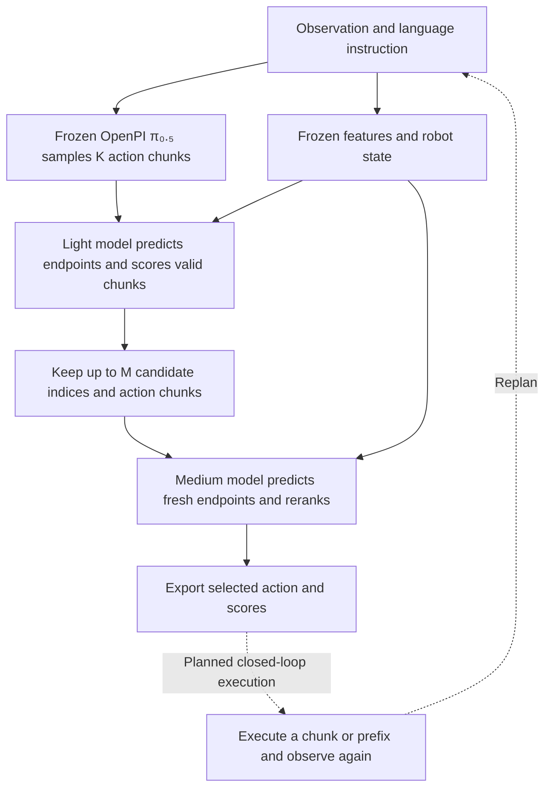

# Cascade-VLA project and architecture

Cascade-VLA studies whether a cheap, action-conditioned world model can prune proposals from a frozen π₀.₅ policy while preserving good actions for a stronger model to rerank. The research goal is to match or improve LIBERO task success at lower end-to-end decision cost than applying the stronger model to every proposal.

## Design decisions and current scope

| Component | Current choice | Status |
| --- | --- | --- |
| Vision-language-action backbone | OpenPI π₀.₅ with the `pi05_libero` checkpoint | Project choice. The adapter is implemented, and the policy weights stay frozen. |
| Light and medium world models | Two sizes of the same action-conditioned latent endpoint transformer | Inherited from the uploaded research prototype and integrated as experimental controls. The prototype describes the design as WAVE-0-inspired and trains its own weights. The final world-model architecture remains open. |
| Benchmark | LIBERO on MuJoCo, with matched-state branches | Collection and offline evaluation are implemented. Simulator replay and branch export were verified with scripted proposals. |
| Closed-loop policy | Execute the winning chunk or a fixed prefix, observe again, and replan | Proposed. The current batched inference path exports selected actions from a saved pool. |

Trained π₀.₅ rollouts, GPU training of the prototype world models, and their ranking quality on held-out LIBERO pools remain unverified. The repository includes a pinned runtime and a synthetic CPU smoke workflow. [Current progress](progress.md)

## End-to-end architecture

The control exports **K=256** proposals, retains up to **M=16**, and returns one final chunk. K, M, and inference batch sizes are configurable. The small collection pilot uses eight proposals per branch pool and evaluates pruning at M=4. The [scaling plan](docs/world-model-improvements.md#candidate-pool-scale) specifies how to test larger pools and models. [Pilot commands](docs/libero-pilot.md)

### Frozen π₀.₅ proposal generator

OpenPI's `pi05_libero` policy uses a SigLIP So400m/14 image encoder with a PaliGemma language and vision prefix and a Gemma 300M action expert. The expert conditions on the prefix and integrates a learned flow from Gaussian noise toward an action chunk. The adapter prepares the observation with the upstream transforms, draws independent seeded noise of shape `[K, 10, 32]` in microbatches, and preserves OpenPI's action output transforms. The policy uses 32 internal action coordinates and returns **10 steps × 7 controller coordinates** per candidate. The default sampler uses ten integration steps. The pinned policy builds a prefix cache within each denoising call. The adapter currently repeats prefix work across candidate batches. [OpenPI configuration](https://github.com/Physical-Intelligence/openpi/blob/215abfb217dbac7d5f1273282331b9b1866c0479/src/openpi/training/config.py) · [OpenPI model](https://github.com/Physical-Intelligence/openpi/blob/215abfb217dbac7d5f1273282331b9b1866c0479/src/openpi/models/pi0.py) · [Adapter](cascade_wam/world_models/pi05_adapter.py)

LIBERO observations provide the base and wrist views, instruction, and robot proprioception. The adapter observation includes proprioception, and the latent world models explicitly use it. The pinned `pi05_libero` proposal config sets `discrete_state_input=False`, and the π₀.₅ action expert in that configuration receives image and text conditioning and denoising-time embeddings. [OpenPI input transforms](https://github.com/Physical-Intelligence/openpi/blob/215abfb217dbac7d5f1273282331b9b1866c0479/src/openpi/transforms.py)

### Feature interface for both world models

| Input | Default shape per candidate | Construction |
| --- | --- | --- |
| Current visual features `z` | `[32, 2048]` | Extract projected SigLIP patch embeddings from frozen π₀.₅. Spatially average them into a 4 × 4 grid per camera, concatenate the two views, and standardize each token. |
| Proprioceptive state `state` | `[8]` | Concatenate end-effector position, axis-angle orientation, and gripper joint positions. Apply training-set normalization. |
| Action chunk `actions` | `[10, 7]` | Use the denormalized OpenPI controller commands, apply the checkpoint's controller bounds policy, then normalize with training statistics. |
| Instruction `goal` | `[2048]` | Average the frozen language input embeddings over valid prompt tokens, then standardize the vector. |
| Recorded future `future` | `[32, 2048]` | Encode the post-action observation using the same camera feature extraction. Used for offline training and diagnostics. |

Current visual features, state, and instruction are shared across candidates in a pool. The feature ID identifies the checkpoint, backend, and extraction settings. Checkpoints carry the feature ID, input dimensions, normalization, controller bounds, and outcome protocol. The cascade checks that the light and medium checkpoints can score the same pool. [Feature extraction](cascade_wam/world_models/pi05_adapter.py) · [Cascade compatibility](cascade_wam/world_models/run_cascade.py)

### Light world model

The light model is the first-stage pruner. Its default width is **256**, with **four** dynamics blocks and **eight** attention heads. It has **8,833,537** trainable parameters per member with the default π₀.₅ feature layout. It predicts one endpoint for each valid proposal and ranks proposals by predicted success. `Pruner.rank` supports optional uncertainty and near-duplicate filtering. For the cascade's default call, both optional adjustments are zero. [Model and ranking code](cascade_wam/world_models/light_world_model.py) · [Training presets](cascade_wam/world_models/train_models.py)

### Medium world model

The medium model is the second-stage reranker. Its default width is **512**, with **eight** dynamics blocks and **eight** attention heads. It has **49,939,457** trainable parameters per member. It uses the same inputs and endpoint target as the light model and is trained independently. It takes the original observation features and the surviving action chunks and makes its own predictions. [Batched cascade code](cascade_wam/world_models/run_cascade.py)

### Shared dynamics and scoring architecture

1. **Encode the ordered actions.** Project each controller command, add its learned time-position embedding, and run a two-layer Transformer encoder over all ten action tokens.
2. **Predict change in latent space.** Concatenate the 32 projected current image tokens, one state token, the ten action tokens, and 32 learned future-query tokens. Each residual dynamics block applies self-attention and an MLP. An adaptive LayerNorm path uses the mean encoded action to modulate both sublayers. Read the future-query outputs, project them back to 2,048 channels, and add the predicted residual to the current visual tokens.
3. **Score the endpoint.** Project the instruction to a query and cross-attend to the predicted visual tokens. An MLP combines the attended features with the instruction vector to produce a task-success logit. The dynamics predictor receives visual features, state, and actions. The scoring head receives the endpoint and instruction.
4. **Rank the candidates.** With a trained checkpoint, divide each member's logit by its fitted temperature and apply the sigmoid. The default ranking uses the mean predicted success across members. Controller checks enforce numerical validity and configured bounds. Physical feasibility and collision prediction are open capabilities.

The current models forecast a single visual endpoint in latent space. Intermediate frames, explicit contact state, and future robot proprioception are outside their outputs. A wider endpoint model tests capacity within this representation. The proposed temporal and wrist-focused variants test whether richer inputs and targets capture events such as slips and missed grasps. [Architecture code](cascade_wam/world_models/light_world_model.py) · [Improvement plan](docs/world-model-improvements.md)

### Planner interfaces and outputs

The dependency-light `HierarchicalPlanner` consumes individual proposals and caller-provided scorers, applies a configurable light-stage feasibility threshold, and returns a single winner plus scores and model-call counts. The learned pilot uses a batched saved-pool path. `run_pruner` can export an unranked pool with observation features, and `run_cascade` evaluates light on the controller-valid candidates and medium on the survivors. It exports the selected chunks, original pool indices, light and medium scores, and survivor membership. The scores for candidates skipped by the medium stage are marked with `NaN`. [Generic planner](cascade_wam/planning.py) · [Pool exporter](cascade_wam/world_models/run_pruner.py) · [Batched cascade](cascade_wam/world_models/run_cascade.py)

## Offline data, training, and evaluation

1. **Collect matched branches.** The LIBERO collector seeds and resets the simulator, restores an official initial state, settles the robot, and replays a fixed action prefix. It verifies simulator state, both camera inputs, and proprioception before each alternative. It executes the candidate chunk until completion or early task success and records the resulting visual features. The label is task success by the end of the candidate plus a fixed-budget, seeded π₀.₅ continuation. The offline oracle uses those observed labels to determine whether a pool contained a successful option. Recorded successors and labels stay in the benchmark path. [Collector](cascade_wam/world_models/collect_libero.py)
2. **Prepare the dataset.** Validate feature layout, controller behavior, and the outcome protocol across shards. Keep sibling candidates, prefixes, and repeated seeds from each simulator starting condition in the same training, validation, calibration, or test split. Fit normalization on training rows and save it with the cache manifest and dataset fingerprint. [Training data preparation](cascade_wam/world_models/prepare_training.py)
3. **Train and calibrate each model.** The predictor learns from cosine distance between predicted and recorded visual endpoints, plus smooth L1 loss on their changes from the current features. After the dynamics warmup, the value head learns binary cross-entropy on actual and detached predicted endpoints plus pairwise ranking on successful and failed siblings. Detaching predicted features keeps the value and ranking gradients out of the predictor. Choose model weights by validation cross-entropy and fit temperatures on the separate calibration split. [Training objective](cascade_wam/world_models/train_models.py)
4. **Evaluate the same held-out pools.** Report random selection, light-only, medium-on-all, random-prune-then-medium, the cascade, and the simulator oracle. Measure successful-candidate retention conditional on a pool containing a success, top-1 selection, calibration, and scorer latency. The actual-future diagnostic feeds recorded and predicted post-action features through the same heads. For medium reranking, it compares both on the same predicted-light survivors. Use validation for development and reserve the test split for the final comparison. [Offline evaluator](cascade_wam/world_models/evaluate_models.py)
5. **Measure closed-loop performance.** The planned runner will execute a chunk or fixed prefix and replan at the same cadence for each method. Compare with the official single-sample π₀.₅ baseline on paired task and seed schedules. Record task success, proposal and scoring latency, total decision latency, and peak memory. The current evaluator times scoring on precomputed features. [Benchmark protocol](docs/libero-pilot.md#read-the-report)

## Milestones and exit checks

| Milestone | Deliverable | Exit check |
| --- | --- | --- |
| 1. π₀.₅ baseline | Reproducible OpenPI and LIBERO commands, run metadata, and candidate pool export | Run the standard policy on a documented suite and seeds. Verify distinct noise draws, valid outputs, and report action diversity plus sampling latency. |
| 2. Matched-state benchmark | Branch collector, outcome labels, and offline oracle | Verify restoration of the simulator state and repeatability of a fixed branch. Report pool sizes, outcome mix, the share of pools with a successful candidate, and the resulting oracle gap. |
| 3. Lightweight pruner | Trained endpoint predictor and goal-conditioned ranker | Evaluate on held-out pools with successful candidates. Report how often at least one success survives, plus ranking and calibration quality. |
| 4. Medium reranker | Trained medium model and representation diagnostic | Score actual post-action features and predicted features on the same held-out pools. Measure whether reranking improves final selection over the light model on the same survivors. |
| 5. Closed-loop evaluation | Reproducible comparison with cost and task outcomes | Compare paired runs with uncertainty estimates. Report task success, decision latency by stage, peak GPU memory, and compute–success curves across K and M. |

For runnable instructions, see the [LIBERO pilot guide](docs/libero-pilot.md). For the next research tasks and the repository map, see [progress.md](progress.md) and [AGENTS.md](AGENTS.md). The [README](README.md) describes the original proposal and research questions.
